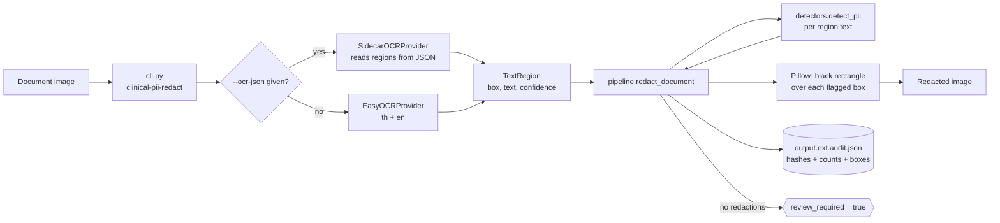
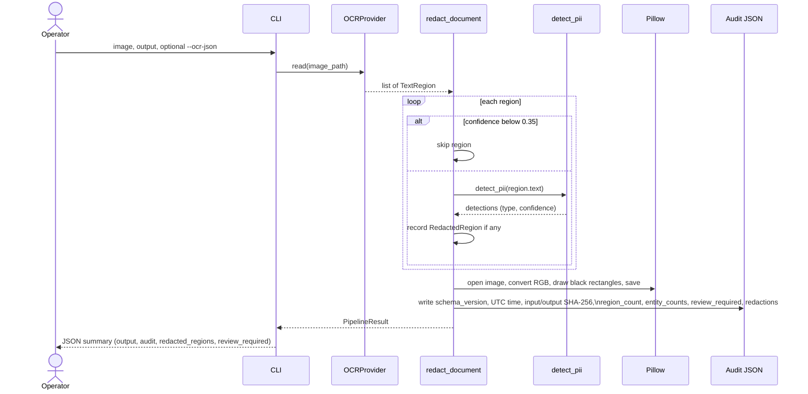
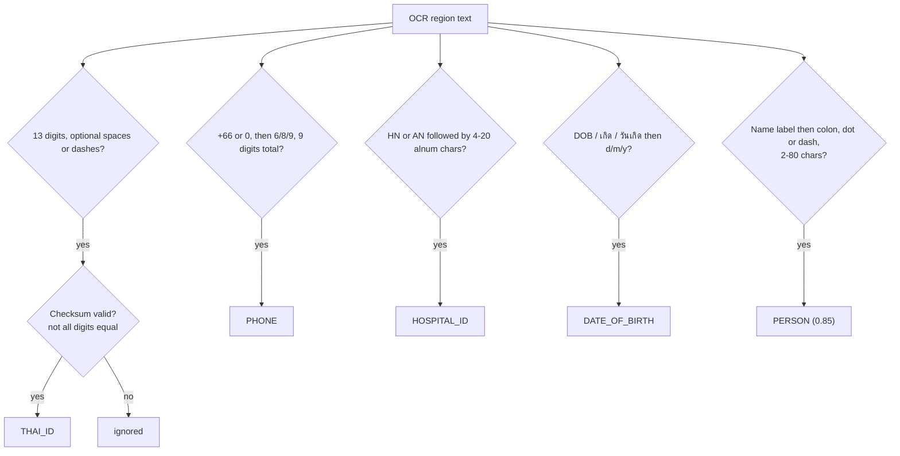
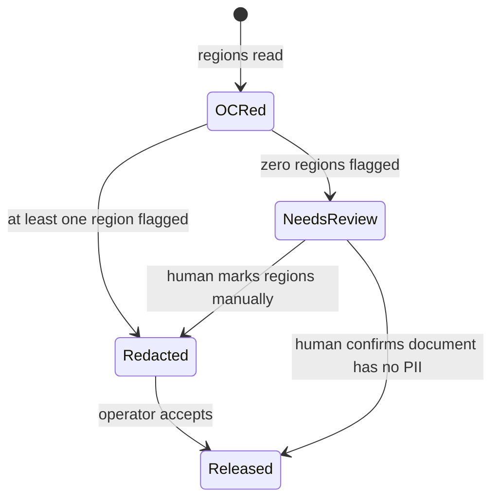
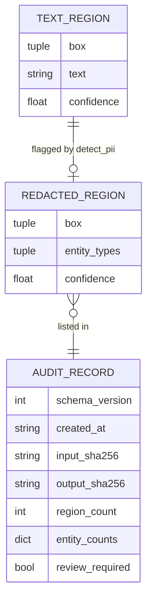

<div align="center">

# Thai Clinical PII Redactor (implementation)

**Clean-room, privacy-first redaction of synthetic Thai clinical document images.**

      

<p align="center">
  
</p>

</div>

> **Status: prototype, not a PDPA certification and not a production medical system.** Public overview: `Dxrksvng/thai-clinical-pii-redactor`. Everything here is exercised only against synthetic data. This repository was rebuilt from scratch as a personal engineering project; it contains no employer source code, patient data, internal architecture, production configuration or confidential evaluation material, and it does not represent any employer's security practices.

Last updated: 2026-11-03. Behaviour below is read from `src/clinical_pii_redactor/*.py` and `tests/`; nothing was executed for this README.

---

## Problem

Clinical documents (lab sheets, referral forms, prescriptions) carry direct identifiers: Thai national ID, phone, hospital number, date of birth, patient name. Sharing them for research, model development or support needs those identifiers removed from the image itself, not just from extracted text. Blur and pixelation can be reversed; and tools that log OCR text leak the very data they remove. This project explores a small, auditable baseline: deterministic rules over OCR output, opaque black rectangles, and an audit trail that stores only metadata.

## Design principles

| Principle | What it means in code |
|---|---|
| Irreversible masking | `redact_document` draws opaque black rectangles with Pillow `ImageDraw` over the OCR box; no blur, no pixelation. |
| No PII in logs | The audit JSON stores hashes, counts, boxes, entity types and confidence only. A test asserts the raw string does not appear in the audit text. |
| Zero detections is not safe | `review_required = not redactions`. A document with no detected PII is routed to human review. |
| Deterministic and testable | Regex plus checksum rules. `SidecarOCRProvider` replays pre-computed OCR regions from JSON so tests and demos need no model weights. |
| Swappable OCR | `OCRProvider` is a `Protocol`; EasyOCR is an optional extra. |
| Conservative names | A name is redacted only after an explicit label (`ชื่อ`, `ชื่อผู้ป่วย`, `patient name`, `name`). Free-floating names are not detected. |

---

## Repository layout

```
thai-clinical-pii-redactor-impl/
├── pyproject.toml                  package + extras + pytest config
├── LICENSE                         MIT
├── src/clinical_pii_redactor/
│   ├── __init__.py
│   ├── ocr.py                      TextRegion, OCRProvider protocol, EasyOCRProvider
│   ├── detectors.py                regex rules, Thai ID checksum, detect_pii()
│   ├── pipeline.py                 redact_document(), audit record, PipelineResult
│   └── cli.py                      clinical-pii-redact entry point, SidecarOCRProvider
├── examples/
│   ├── synthetic_document.png      synthetic demo image
│   ├── synthetic_document.svg
│   └── synthetic_regions.json      pre-computed OCR regions (4 lines)
└── tests/
    ├── test_detectors.py
    └── test_pipeline.py
```

---

## Tech stack

| Layer | Choice (from `pyproject.toml`) |
|---|---|
| Language | Python >= 3.10 |
| Imaging | Pillow >= 10.0 (core dependency) |
| OCR (optional extra `ocr`) | EasyOCR >= 1.7 (languages `th`, `en`), opencv-python-headless >= 4.10 |
| Packaging | setuptools >= 69, console script `clinical-pii-redact` |
| Tests (extra `dev`) | pytest >= 8.0 |
| License | MIT |

---

## System architecture



## Flow 1: Redaction sequence



## Flow 2: Detector decision

Rules in `detectors.py` (all reported with confidence 1.0 and detector `rule`, except names at 0.85 with detector `label-context`).



Thai national ID checksum (`thai_id_checksum_is_valid`): weights 13 down to 2 over the first 12 digits, check digit is `(11 - sum mod 11) mod 10`.

## Flow 3: Review state



ASSUMPTION: `Released` and the manual-marking edge are the intended human workflow, not code; the repository only sets the `review_required` flag.

---

## Interfaces

No HTTP API. Interfaces are the CLI and the Python API.

| Interface | Detail |
|---|---|
| CLI | `clinical-pii-redact <image> <output> [--ocr-json regions.json]` prints a JSON summary |
| `detect_pii(text) -> list[Detection]` | `Detection(entity_type, value, start, end, confidence, detector)` sorted by position |
| `redact_document(image_path, output_path, ocr, *, minimum_ocr_confidence=0.35) -> PipelineResult` | Writes the image and `<output>.audit.json` |
| `OCRProvider.read(image_path) -> list[TextRegion]` | Protocol for custom OCR adapters |

## Data model



`TextRegion.text` is never persisted. `Detection.value` exists in memory only.

---

## Quick start (from the previous README, which matches `pyproject.toml` and `cli.py`)

```bash
python -m venv .venv
source .venv/bin/activate
pip install -e '.[dev]'
pytest -q

# deterministic synthetic demo (no model download)
clinical-pii-redact examples/synthetic_document.png output/redacted.png \
  --ocr-json examples/synthetic_regions.json

# real OCR path
pip install -e '.[ocr]'
clinical-pii-redact input.png output/redacted.png
```

## Testing evidence

Five tests exist (counted from `def test_` in `tests/`, not executed for this README, no recorded run in the repository):

- `test_valid_thai_id_checksum`: a known-valid synthetic ID passes, a one-digit change fails.
- `test_detects_explicit_clinical_pii`: name label, HN and phone are detected in one line.
- `test_does_not_treat_arbitrary_text_as_name`: unlabelled shop name is not flagged.
- `test_redacts_pixels_and_excludes_raw_pii_from_audit`: pixel at (20, 20) turns black, raw string absent from the audit, `entity_counts == {"HOSPITAL_ID": 1}`.
- `test_no_box_fails_to_human_review`: empty OCR result sets `review_required`.

There is no accuracy measurement: no corpus, precision, recall or leakage-rate result exists yet.

## Security, privacy and limitations

Observed in code, not just stated policy:

- **Whole-box redaction.** The entire OCR box is blacked out, not only the matched substring, so adjacent non-PII text in the same OCR line is lost. This errs on the safe side.
- **Low-confidence OCR is skipped.** Regions with OCR confidence below 0.35 are ignored entirely, and `review_required` is only true when nothing at all was redacted. A document with one detection plus several unreadable low-confidence regions would not be flagged for review. Consider flagging skipped regions.
- **Review flag is all or nothing.** `review_required` does not capture partial misses.
- **Rule coverage is narrow.** Passport numbers, addresses, email, barcodes/QR, signatures, photos, handwriting and names without a label are not detected. Thai-script OCR errors can break the regexes.
- **Audit contents.** The audit lists input and output SHA-256 and pixel boxes. Hashes of real patient files could act as identifiers; keep audit files access-controlled.
- **Sidecar mode.** `SidecarOCRProvider` ignores the image content and returns the JSON regions; use only for demos and tests.
- Output images are re-encoded through Pillow (RGB), which drops embedded metadata such as EXIF; this is not documented as a guarantee.
- Not evaluated against any real clinical document. Do not use on real patient data without an independent evaluation and a PDPA legal review (health data is sensitive personal data).

## Evaluation roadmap (from the previous README)

1. Generate or license a Thai synthetic document corpus.
2. Annotate PII boxes by entity type.
3. Split by template/source to prevent leakage.
4. Report per-class precision, recall, F1 and document-level leakage rate.
5. Add Thai NER and barcode detection behind versioned adapters.
6. Require human review for low-confidence and no-box cases.

Additional items suggested by the code review above: flag skipped low-confidence regions, add email/address/passport rules, and add a test for partially redacted documents.

## License

MIT. Synthetic or third-party datasets keep their own licenses and are not included here.
